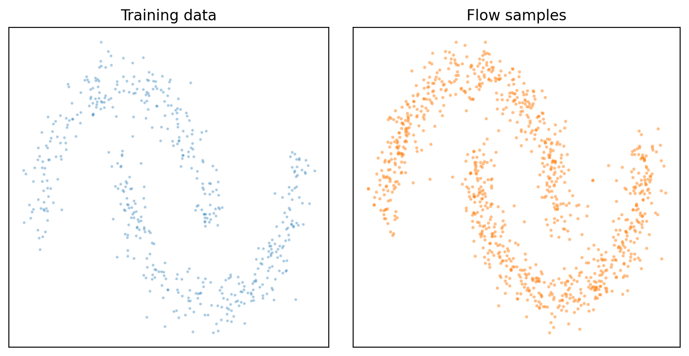

# generax

`generax` is a JAX and Equinox library for normalizing flows with practical support for tabular vectors and images.

## Install

```bash
pip install generax
```

## Why generax

- wide coverage of invertible transforms including coupling, affine, spline, convolutional, and continuous flows
- same modeling interface for flat data and image data
- data dependent initialization built into flow modules
- Equinox modules that work naturally with `jax.jit`, `jax.vmap`, and `jax.grad`



## Quickstart with flat data

```python
import equinox as eqx
from jax import random
import generax as gx

key = random.PRNGKey(0)
x = ...  # [batch, dim]

flow = gx.NeuralSpline(
  input_shape=x.shape[1:],
  n_flow_layers=3,
  n_blocks=4,
  hidden_size=32,
  working_size=16,
  n_spline_knots=8,
  key=key,
)

flow = flow.data_dependent_init(x, key=key)

keys = random.split(key, 1024)
samples = eqx.filter_vmap(flow.sample)(keys)
log_prob = eqx.filter_vmap(flow.log_prob)(x)
```

## Quickstart with image data

```python
import equinox as eqx
import jax.numpy as jnp
from jax import random
import generax as gx

key = random.PRNGKey(1)
x_img = jnp.zeros((32, 32, 32, 3))  # [batch, height, width, channels]

transform = gx.NeuralSplineImageTransform(
  input_shape=x_img.shape[1:],
  n_flow_layers=3,
  key=key,
)

image_flow = gx.NormalizingFlow(
  transform=transform,
  prior=gx.Gaussian(input_shape=x_img.shape[1:]),
)

image_flow = image_flow.data_dependent_init(x_img, key=key)
image_log_prob = eqx.filter_vmap(image_flow.log_prob)(x_img)
```

## Equinox friendly workflow

```python
import equinox as eqx

@eqx.filter_jit
def mean_log_prob(model, x):
  return eqx.filter_vmap(model.log_prob)(x).mean()
```

## Composable transforms

You can build custom flows by composing invertible layers directly.

```python
from jax import random
import generax as gx

k1, k2 = random.split(random.PRNGKey(0), 2)
transform = gx.Sequential(
  gx.Reverse(input_shape=(16,)),
  gx.PLUAffine(input_shape=(16,), key=k1),
  gx.ShiftScale(input_shape=(16,), key=k2),
)

flow = gx.NormalizingFlow(
  transform=transform,
  prior=gx.Gaussian(input_shape=(16,)),
)
```

## Included models and layers

- ready to use flow models like `RealNVP`, `NeuralSpline`, and `ContinuousNormalizingFlow`
- flat and image transform stacks like `RealNVPTransform`, `NeuralSplineTransform`, and `NeuralSplineImageTransform`
- affine and coupling layers like `Shift`, `ShiftScale`, `PLUAffine`, and `Coupling`
- convolutional invertible layers like `OneByOneConv`, `CircularConv`, `HaarWavelet`, and `PACFlow`
- spline and continuous layers like `RationalQuadraticSpline` and `FFJORDTransform`
- utility invertible layers like `Reverse`, `Squeeze`, `Flatten`, and `Checkerboard`

## More examples

See [`examples/`](examples) for complete scripts, including

- [`examples/spline_max_likelihood.py`](examples/spline_max_likelihood.py)
- [`examples/mnist_cnf.py`](examples/mnist_cnf.py)
- [`examples/cifar10_cnf_fm.py`](examples/cifar10_cnf_fm.py)
- [`examples/mnist_rect_flow.py`](examples/mnist_rect_flow.py)
